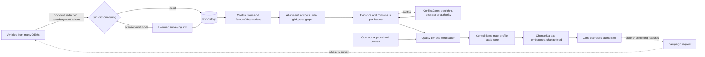
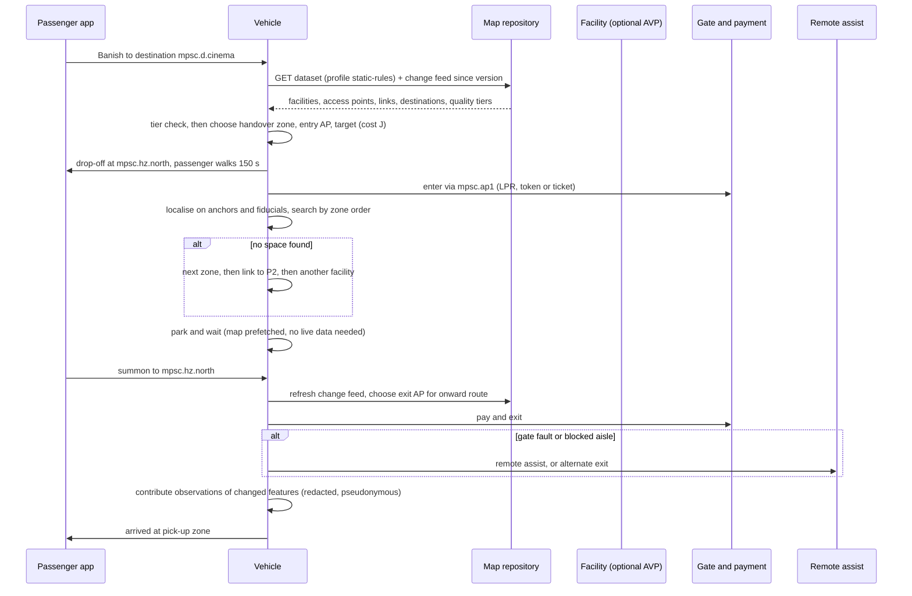

# OPMS: Open Parking Map Schema, v0.2 (draft)

Status: **draft for discussion, not published, not endorsed by any company or standards body.** Version 0.2.0, 2026-11-23.
Licence: this text is CC BY 4.0; the JSON Schemas and tools are Apache-2.0 (see `LICENSE`).

All example organisations, roads, IDs, prices and coordinates in this repository are **fictional**. Nothing here describes the internal workings of any vehicle manufacturer. Jurisdiction examples are illustrations, not legal advice.

## 1. Purpose and scope

Vehicles that drop a passenger at a destination, find a parking space on their own and later return need a shared, machine-readable description of parking: street kerbs, surface lots, multi-storey and underground garages, mechanical parking, private garages, and large sites such as shopping centres, airports and hospitals that contain several complexes with many entrances and exits.

OPMS describes the **static** structure of those places (levels, ramps, aisles, bays, pillars, access points, gates, links between complexes, destinations and kerb rules) and the **records that let many parties build and maintain that structure by crowdsourcing**: contributions, observations, evidence, conflict handling, change feeds, quality tiers and jurisdiction routing.

OPMS is a **glue layer**. It does not replace HD map formats or facility-data standards; it links to them by identifier (section 2).

Non-goals in v0.2: live space availability (optional extension only, section 9), wire protocols between a vehicle and a facility (ISO 23374 leaves them open), vehicle control, and payment processing.

## 2. Relationship to existing work

| Existing work | What OPMS does with it |
|---|---|
| ASAM OpenDRIVE (1.9 `parkingSpace` object) | Link by `external_refs.opendrive`. OpenDRIVE has parking-space outlines and an access enum but no multi-storey topology, access points, gates or crowdsourcing records. |
| Lanelet2 / Autoware maps | Link by `external_refs.lanelet2_ids`. Lane-level geometry stays in Lanelet2; OPMS adds site structure and governance. |
| SENSORIS (v1.3.1) | Vehicle-to-cloud upload and cloud-to-vehicle campaign formats. OPMS `Campaign` mirrors the campaign concept; `Contribution.payload_ref` can point at SENSORIS messages. OPMS defines what a consolidated parking map looks like once the data has arrived. |
| ISO/TS 22726-1:2025 (static map data logical model) | Intended mapping target for geometry classes. OPMS entities should be mapped to the ISO logical model; this mapping is future work. |
| NDS.Live (AVP task force) | NDS.Live defines a map database format and services, including AVP use cases. OPMS is a neutral interchange description; a mapping to NDS.Live parking structures is future work. |
| ISO 23374-1:2023 and ISO/TS 23374-2:2023 | OPMS records the AVPS type (1, 2, 3) and handover areas per facility (`Facility.avp`, `HandoverZone.iso23374_handover`). The protocol stays out of scope. |
| OGC IndoorGML 2.0 | Link cells by `external_refs.indoorgml_cell`. IndoorGML has no parking profile; levels, zones and drive edges can be exported as IndoorGML spaces and connectivity. |
| OMF Curb Data Specification | `CurbSegment`, `Rule` and `HandoverZone` follow CDS ideas (zones, time-conditioned regulations, pick-up/drop-off). `external_refs.cds_zone_id` links records. |
| APDS (4.1 verified; v5 reported finalised) | OPMS reuses the APDS Place hierarchy by reference (`apds_place_id`, `apds_subplace_id`, `apds_identified_area_id`, `apds_space_id`) rather than defining a parallel one. Rates follow APDS conventions. |
| T/CSGPC 031-2024 (China, crowd-sourced updating of intelligent-vehicle basemaps) | A group standard covering data sources, map updating, transmission, review and release. OPMS `Contribution`, `ChangeSet` and `Jurisdiction` cover the same ground in neutral form. |
| T/CSAE 261-2022 (China, autonomous valet parking: map and localisation technical requirements) | Found via search results; not reviewed in full. A candidate source for mapping parking-facility map and localisation requirements into OPMS quality tiers. |
| MNR Notice 自然资发〔2024〕139号 | Drives the `via_licensed_unit` routing mode and residency fields (section 8). |
| OpenStreetMap parking tags | Import source and link target (`external_refs.osm`). |
| EAVP (ERTICO), MAZE facility maps | Complementary; interoperability with MAZE is an open question (2.1). |
| ISO/TS 5206-1:2023 (parking core data model) | Link by `external_refs.iso5206_id`. |
| China draft national standard plan 20243535-T-466 (parking HD navigation map data model) | Conceptual overlap; mapping is future work (2.1). |
| Autoware Lanelet2 parking extension | `parking_lot` / `parking_space` areas map to OPMS zones and bays via `lanelet2_ids`. |

### 2.1 Related work and how OPMS fits

OPMS is meant to be a **complementary open profile**, not a rival to existing work. The closest efforts are:

- **EAVP (Enhancing Automated Valet Parking)**, an ERTICO innovation platform (started 2022; ERTICO lists 10 partners). ERTICO describes three pillars: standardised parking data through APDS, connected parking with traffic circulation planning, and indoor guidance. It describes shared facility maps in **Valeo's MAZE format**, opened to EAVP and the European Parking Association, with a target of 3,000+ mapped facilities and a Salzburg proof of concept planned for late 2026. Sources: https://eavp.eu/ and https://www.ertico.com/what-we-do/platforms-mobility-spaces/eavp and https://www.ertico.com/eavp-at-intertraffic-amsterdam-standardising-connected-parking-services-for-next-generation-cities
- **APDS (Alliance for Parking Data Standards).** APDS 4.1 defines a place hierarchy: Campus (optional), Place, SubplaceElement, IdentifiedArea and (optionally) Space. ERTICO reports that APDS v5 has been finalised; the public API specification I could verify is 4.1. OPMS does **not** build a parallel hierarchy: it links to APDS records through `external_refs.apds_place_id`, `apds_subplace_id`, `apds_identified_area_id` and `apds_space_id`. A proposed mapping (to be validated with APDS): `Site` is an APDS Campus or Place; `Facility` is a Place; `Level` and `Zone` are SubplaceElements or IdentifiedAreas; `Bay` is a Space. Source: https://allianceforparkingdatastandards.org/wp-content/uploads/2026/03/APDS-Information-Model-v4.1-final.pdf
- **ISO/TS 5206-1:2023 (Parking, Part 1: Core data model).** Published technical specification covering on-street and off-street parking concepts for business-to-business exchange and end-user services. OPMS links by `external_refs.iso5206_id`. Source: https://www.iso.org/standard/80997.html
- **China's draft national standard plan 20243535-T-466, 《停车场高精导航地图数据模型与表达》** (parking-lot HD navigation map data model and expression), led by TC230 under the Ministry of Natural Resources; the plan page lists it as out for comment. It covers roads, lanes, road facilities, parking facilities and index points, including parking spaces, areas, floors, pillars and gates. OPMS entities overlap conceptually; a formal mapping is future work. Sources: https://std.samr.gov.cn/gb/search/gbDetailed?id=2ACFE99EA9AFFAE1E06397BE0A0AD0BA and https://std.samr.gov.cn/gb/search/gbDetailed?id=20CD58A3021FAB0AE06397BE0A0AD72B
- **Jiang et al. (2024), "Dynamic indoor mapping for AVP: Crowdsourcing mapping without prior maps", IET Intelligent Transport Systems**, https://doi.org/10.1049/itr2.12578. Research on crowdsourced mapping methods. OPMS does not specify a mapping algorithm; it provides the data envelope (contributions, evidence, alignment records) around such methods.
- **Autoware / Lanelet2 parking extension.** Autoware's `lanelet2_extension` represents a parking lot as an Area with `subtype=parking_lot` and a stall as a LineString with `subtype=parking_space`; Autoware.Auto's AVP demo uses Areas with `subtype=parking_spot` and `parking_access` plus `ref_lanelet` tags. OPMS links by `external_refs.lanelet2_ids`. Sources: https://docs.ros.org/en/ros2_packages/rolling/api/autoware_lanelet2_extension/generated/program_listing_file_include_autoware_lanelet2_extension_utility_query.hpp.html and https://autowarefoundation.gitlab.io/autoware.auto/AutowareAuto/lanelet2-map-for-autoware-auto.html

**What OPMS adds (its distinct contribution):**

1. An **open multi-OEM contribution and merge layer**: contributions, observations, evidence, conflict handling and change sets that work no matter which maker collected the data.
2. A **static-only core profile**: nothing requires live availability.
3. **Quality tiers for driverless use**, with certification and operator consent.
4. **Jurisdiction routing outside Europe**, including Australia and a licensed-unit mode for countries that require it.
5. A **human-centred design lens**: accessibility, wayfinding, personal safety and open data as first-class parts of the model.

**Open questions on fit:** how to interoperate with MAZE (whether and how its specification is available to non-members is not known to me); which APDS v5 classes OPMS should reference once the specification is public; how OPMS maps to the Chinese draft model; whether OPMS should become an APDS extension or stay a separate profile that references it.

## 3. Layers and profiles

Information is split into layers that change at different speeds and can be published separately:

1. **Static geometry and topology** (changes monthly): frames, facilities, levels, zones, bays, drive graph, access points, gates, links, anchors, pillars.
2. **Site semantics and regulations** (changes weekly): destinations, portals, handover zones, kerb segments, rules, rates.
3. **Crowdsourcing and governance records** (change per submission): contributors, contributions, observations, alignment records, evidence, conflict cases, change sets, quality tiers, jurisdictions.
4. **Dynamic state, OPTIONAL** (changes in seconds): occupancy, closures.
5. **Services, OPTIONAL** (per trip): reservations, sessions, missions.

A dataset declares one cumulative **profile**:

| Profile | Adds | Notes |
|---|---|---|
| `static-core` (default) | layer 1 | No rules, destinations or live data. Enough for localisation, routing and search by a car. |
| `static-rules` | layer 2 | Adds destinations, portals, handover zones, kerb segments, rules and rates. |
| `dynamic` | layer 4 | Adds an optional live feed (`dynamic`). Not required by anything else. |
| `services` | layer 5 | Adds optional `services`. Not yet schematised in v0.2. |

The root schema enforces this: a `static-core` dataset may not contain layer 2 keys, and a `static-core` or `static-rules` dataset may not contain `dynamic` or `services`. **A conforming consumer MUST work with `static-core` alone.** Live occupancy is never required; a car searching a car park without it uses zone ordering, bay-type hints and its own sensing.

## 4. Conventions

- **Frames.** Every facility has a local Cartesian frame (x east, y north, z up, metres) anchored to WGS84 by an origin (`lat`, `lon`, ellipsoidal height) and the bearing of the x axis. Indoor geometry is local; road links and site outlines are WGS84. Levels carry an integer `ordinal` (0 ground, negative below) plus the signed `label`.
- **Units.** SI: metres, seconds, kilograms; km/h for signed speed limits. Money is a decimal string with an ISO 4217 currency.
- **Time.** RFC 3339 date-times with offset. `TimeWindow` values are local to the site's IANA timezone (`24:00` is allowed as an end).
- **IDs.** Lower-case dotted strings, stable and never reused, e.g. `mpsc.p1.l2.b0231`. External identifiers live in `external_refs`.
- **Provenance.** Any feature may carry `provenance` (`source`, `observed_at`, `confidence`, supporting `contribution_ids`, `change_set_id`), `evidence`, `lifecycle` (`active`, `superseded`, `retired`), `supersedes`, and validity dates.
- **Safe defaults.** Unknown means not allowed: a missing rule is not permission, a missing clearance blocks oversize vehicles, and unverified features are not used for driverless operation.
- **Versioning.** `opms_version` is the schema version (0.x: breaking changes allowed). `dataset_version` labels a snapshot of one site. Differences between snapshots are published as `ChangeSet` records.
- **Extensions.** Objects accept properties prefixed `x_`; other unknown properties are rejected.

```mermaid
erDiagram
  SITE ||--o{ FACILITY : contains
  SITE ||--o{ DESTINATION : has
  SITE ||--o{ HANDOVER_ZONE : has
  SITE }o--|| JURISDICTION : "governed by"
  JURISDICTION ||--|| REPOSITORY : "routes to"
  JURISDICTION ||--o| RESOLUTION_POLICY : uses
  JURISDICTION ||--o| REDACTION_POLICY : requires
  FACILITY ||--|| FRAME : "anchored by"
  FACILITY ||--o{ LEVEL : has
  FACILITY ||--o{ ACCESS_POINT : "entered or exited via"
  FACILITY }o--o{ INTER_FACILITY_LINK : "joined by"
  FACILITY ||--o| APPROVAL_STATUS : "consent"
  FACILITY ||--o| QUALITY_TIER : declares
  QUALITY_TIER }o--o{ CERTIFICATION : "backed by"
  ACCESS_POINT ||--o{ GATE : has
  ACCESS_POINT }o--|| PUBLIC_ROAD : "connects to"
  LEVEL ||--o{ ZONE : has
  ZONE ||--o{ BAY : has
  LEVEL ||--o{ DRIVE_EDGE : has
  DRIVE_EDGE }o--o{ BAY : serves
  LEVEL ||--o{ ANCHOR_FEATURE : "aligned by"
  LEVEL ||--o{ PILLAR_GRID : has
  PILLAR_GRID ||--o{ PILLAR : has
  LEVEL ||--o{ LOCALIZATION_AID : has
  DESTINATION ||--o{ PEDESTRIAN_PORTAL : "reached via"
  DESTINATION ||--o{ DESTINATION_ACCESS : "walk times"
  DESTINATION_ACCESS }o--|| HANDOVER_ZONE : to
  RULE }o--o{ BAY : governs
  RULE }o--o{ CURB_SEGMENT : governs
  CONTRIBUTOR ||--o{ CONTRIBUTION : submits
  CAMPAIGN ||--o{ CONTRIBUTION : requests
  CONTRIBUTION ||--|{ FEATURE_OBSERVATION : contains
  CONTRIBUTION ||--o{ ALIGNMENT_RECORD : "aligned by"
  FEATURE_OBSERVATION }o--o| BAY : observes
  FEATURE_OBSERVATION }o--o{ CONFLICT_CASE : "disputed in"
  CONTRIBUTION }o--|| REPOSITORY : "received by"
  CHANGE_SET }o--o{ CONTRIBUTION : "driven by"
  CHANGE_SET ||--o{ TOMBSTONE : removes
  FACILITY ||--o{ CHANGE_SET : "versioned by"
  LEVEL ||--o{ LIFT : has
  LEVEL ||--o{ WAYFINDING_AID : has
  LEVEL ||--o{ SAFETY_FEATURE : has
  BAY ||--o| BAY_ACCESSIBILITY : "accessibility"
  HANDOVER_ZONE ||--o| HANDOVER_ACCESSIBILITY : "accessibility"
  DESTINATION_ACCESS }o--o| ACCESSIBLE_PATH : "step-free route"
  ACCESSIBLE_PATH }o--o{ LIFT : uses
  ACCESSIBLE_PATH }o--o{ WAYFINDING_AID : "guided by"
  PASSENGER_NEEDS ||--o| HANDOVER_REQUIREMENTS : "derives (on device)"
  OCCUPANCY_UPDATE }o--o| BAY : "OPTIONAL state of"
  CLOSURE }o--o{ DRIVE_EDGE : "OPTIONAL affects"
```

## 5. Static entities

Each table is generated from the schema files; the schemas are normative.

### Site

A precinct containing facilities, destinations and handover zones. A site with several complexes (a mall precinct) lists them in `facility_ids`; each facility has its own access points and levels.

Schema: `schema/site.schema.json`

| Field | Type | Req | Description |
|---|---|---|---|
| `id` | Id | yes | Site id. |
| `name` | string | yes | Display name. |
| `kind` | enum | yes | Precinct type. Values: `shopping_centre`, `airport`, `hospital`, `campus`, `residential`, `office`, `event_venue`, `street_precinct`. |
| `timezone` | string | yes | IANA timezone; all time windows are local to it. |
| `ticket_scope` | enum |  | Whether one ticket works across complexes by default. Values: `facility`, `site`. |
| `facility_ids` | Id[] | yes | Complexes in the precinct. |
| `jurisdiction_id` | Id |  | Jurisdiction whose repository and rules govern this site. |
| `locality_class` | enum |  | Used to measure equity of coverage across suburbs and regions, not only premium sites. Values: `metro_premium`, `metro_suburban`, `regional`, `rural`. |


### Frame

Local Cartesian facility frame anchored to WGS84. 

Schema: `schema/frame.schema.json`

| Field | Type | Req | Description |
|---|---|---|---|
| `id` | Id | yes | Frame id. |
| `origin_wgs84` | object | yes | Frame origin on WGS84. |
| `x_axis_bearing_deg` | number | yes | Bearing of the local x axis, clockwise from true north. |
| `anchor_accuracy_m` | number |  | 1-sigma accuracy of the anchoring. |


### Facility

A parking complex. 

Schema: `schema/facility.schema.json`

| Field | Type | Req | Description |
|---|---|---|---|
| `id` | Id | yes | Facility id. |
| `site_id` | Id | yes | Parent site. |
| `name` | string |  | Display name. |
| `type` | enum | yes | Facility type. Values: `surface_lot`, `multi_storey`, `underground`, `rooftop`, `mechanical_stacker`, `robotic`, `private_garage`, `driveway`, `on_street_block`. |
| `frame_id` | Id | yes | Local frame used by all geometry in the facility. |
| `levels` | Level[] | yes | Levels ordered by ordinal. |
| `gnss` | enum |  | Worst GNSS quality across levels. Values: `good`, `degraded`, `none`. |
| `capacity` | integer |  | Total bays. |
| `operating_hours` | TimeWindow[] |  | When vehicles may enter. |
| `exit_hours` | TimeWindow[] |  | When vehicles may leave, if different. |
| `rate_id` | Id |  | Default tariff (static-rules profile). |
| `jurisdiction_id` | Id |  | Jurisdiction; overrides the site's if set. |
| `approval` | ApprovalStatus |  |  |
| `quality_tier` | QualityTier |  |  |
| `licence` | LicenceTerms |  |  |
| `release_restrictions` | enum[] |  | Release restrictions. Values: `no_public_release`, `authority_only`, `tier_gated`, `licensed_unit_only`. |
| `avp` | object |  | Optional AVP service description (services profile; advisory otherwise). |


### Level

A floor of a facility. 

Schema: `schema/level.schema.json`

| Field | Type | Req | Description |
|---|---|---|---|
| `id` | Id | yes | Level id. |
| `ordinal` | integer | yes | 0 = ground; negative below ground. Ordering only. |
| `label` | string | yes | As signed: G, L1, B2, Roof. |
| `elevation_m` | number | yes | Floor height in the facility frame. |
| `clearance_m` | number |  | Lowest headroom. |
| `open_air` | boolean |  | Rooftop or surface. |
| `gnss` | enum |  | GNSS quality on this level. Values: `good`, `degraded`, `none`. |
| `entry_anchor_ids` | Id[] |  | AnchorFeatures that tie this level's local geometry back to a GNSS-visible reference. |


### Zone

A painted area of bays. 

Schema: `schema/zone.schema.json`

| Field | Type | Req | Description |
|---|---|---|---|
| `id` | Id | yes | Zone id. |
| `level_id` | Id | yes | Parent level. |
| `name` | string | yes | Signed name, e.g. Blue C. |
| `bay_types` | Id[] |  | Optional hint of dominant bay classes (free ids such as ev, accessible). |


### Bay

A single parking space. 

Schema: `schema/bay.schema.json`

| Field | Type | Req | Description |
|---|---|---|---|
| `id` | Id | yes | Bay id. |
| `zone_id` | Id | yes | Parent zone. |
| `polygon` | LocalPoint[] | yes | Four corners, counter-clockwise, in the facility frame. |
| `orientation` | enum | yes | Bay orientation. Values: `parallel`, `angle`, `perpendicular`, `stacker_platform`, `robot_pallet`. |
| `angle_deg` | number |  | Angle for angle parking; 90 for perpendicular. |
| `approach_edge` | integer |  | Polygon edge the vehicle enters through. |
| `bay_types` | enum[] | yes | Bay classes. Values: `general`, `accessible`, `ambulant`, `carer`, `ev`, `family`, `pregnancy`, `motorcycle`, `compact`, `reserved`, `tenant`, `permit`, `loading`, `rideshare`, `taxi`, `community_transport`, `ndis_transport`, `patient_transport`, `coach`, `courier`, `oversize_van`, `emergency_services`, `valet`, `staff`. |
| `ev` | object |  | EV charging details. |
| `painted_label` | string |  | Text on the ground. |
| `rule_ids` | Id[] |  | Eligibility and time limits (static-rules profile). |
| `accessibility` | BayAccessibility |  |  |


### DriveNode

A node of the directed drivable graph. 

Schema: `schema/drive-node.schema.json`

| Field | Type | Req | Description |
|---|---|---|---|
| `id` | Id | yes | Node id. |
| `level_id` | Id | yes | Level (or the id of the facility for external nodes). |
| `position` | LocalPoint | yes |  |


### DriveEdge

A directed drivable segment: aisle, ramp, level transition or internal road. Two-way aisles are two edges. Helical and straight ramps are edges of kind `ramp` with a `ramp` object.

Schema: `schema/drive-edge.schema.json`

| Field | Type | Req | Description |
|---|---|---|---|
| `id` | Id | yes | Edge id. |
| `from_node` | Id | yes | Start node. |
| `to_node` | Id | yes | End node. Two-way aisles are two edges. |
| `kind` | enum | yes | Edge kind. Values: `aisle`, `ramp`, `level_transition`, `access_lane`, `internal_road`, `inter_facility`, `lift`, `turntable`. |
| `level_id` | Id |  | Level the edge lies on (start level for ramps). |
| `centreline` | LocalPoint[] |  | Polyline in the facility frame. |
| `width_m` | number |  | Drivable width. |
| `speed_limit_kmh` | number |  | Signed speed limit. |
| `limits` | VehicleLimits |  |  |
| `ramp` | object |  | Ramp geometry. |
| `turn_restrictions` | object[] |  | Banned next edges. |
| `bay_ids` | Id[] |  | Bays reachable from this edge. |
| `shared_with_pedestrians` | boolean |  | Pedestrian priority area. |


### AccessPoint

A vehicle entry, exit or both, tied to a public road. A facility has many access points. Each ties to a public road, states which movements are allowed (turn restrictions), which levels and zones it serves, its hours, limits and credentials, and is entry, exit or both.

Schema: `schema/access-point.schema.json`

| Field | Type | Req | Description |
|---|---|---|---|
| `id` | Id | yes | Access point id. |
| `facility_id` | Id | yes | Complex it serves. |
| `role` | enum | yes | Direction of use. Values: `entry`, `exit`, `both`. |
| `position` | LocalPoint |  |  |
| `road_link` | object | yes | Public road it connects to. |
| `movements_in` | enum[] |  | Allowed entry movements. Values: `left_in`, `right_in`, `straight_in`. |
| `movements_out` | enum[] |  | Allowed exit movements. Values: `left_out`, `right_out`, `straight_out`. |
| `served_level_ids` | Id[] |  | Levels reachable without leaving. |
| `served_zone_ids` | Id[] |  | Zones reachable without leaving. |
| `hours` | TimeWindow[] |  | Opening hours. |
| `limits` | VehicleLimits |  |  |
| `credentials` | enum[] |  | Accepted credentials. Values: `ticket`, `lpr`, `app`, `tap_card`, `rfid`, `permit`, `intercom`, `none`. |
| `gate_ids` | Id[] |  | One per lane. |
| `queue_capacity_veh` | integer |  | Stacking space before blocking the road. |
| `emergency_access` | object |  | Emergency vehicle access. |


### Gate

Boom gate, roller door, bollard or open lane. 

Schema: `schema/gate.schema.json`

| Field | Type | Req | Description |
|---|---|---|---|
| `id` | Id | yes | Gate id. |
| `host_id` | Id | yes | AccessPoint or InterFacilityLink the gate belongs to. |
| `kind` | enum | yes | Gate kind. Values: `boom_gate`, `roller_door`, `bollard`, `open_lane`, `turnstile`. |
| `direction` | enum |  | Lane direction. Values: `in`, `out`, `both`. |
| `actuation` | enum[] |  | How it opens. Values: `ticket`, `lpr`, `app`, `tap_card`, `remote_open`, `intercom`, `manual`, `none`. |
| `limits` | VehicleLimits |  |  |


### InterFacilityLink

A tunnel, bridge, ramp or internal road between two facilities. Describes internal connections between complexes and whether a ticket or session transfers.

Schema: `schema/inter-facility-link.schema.json`

| Field | Type | Req | Description |
|---|---|---|---|
| `id` | Id | yes | Link id. |
| `from` | Id | yes | DriveNode in the first facility. |
| `to` | Id | yes | DriveNode in the second facility. |
| `kind` | enum | yes | Link kind. Values: `tunnel`, `bridge`, `internal_ramp`, `internal_road`, `public_road`. |
| `direction` | enum | yes | Direction. Values: `one_way_forward`, `one_way_reverse`, `two_way`. |
| `ticket_transfer` | object | yes | Whether a ticket or session carries across. |
| `limits` | VehicleLimits |  |  |
| `hours` | TimeWindow[] |  | Hours. |


### LocalizationAid

Fiducial, beacon or landmark for GNSS-denied localisation. 

Schema: `schema/localization-aid.schema.json`

| Field | Type | Req | Description |
|---|---|---|---|
| `id` | Id | yes | Aid id. |
| `level_id` | Id | yes | Level. |
| `kind` | enum | yes | Aid kind. Values: `apriltag`, `aruco`, `ble_beacon`, `uwb_anchor`, `pillar_label`, `painted_marker`, `surveyed_landmark`. |
| `code` | string |  | Tag ID, beacon UUID/major/minor or label text. |
| `pose` | object | yes |  |
| `accuracy_m` | number |  | 1-sigma accuracy. |


### AnchorFeature

A distinctive feature used to align contributions and tie levels to the global frame. Anchors tie levels to the global frame and constrain alignment of contributions.

Schema: `schema/anchor-feature.schema.json`

| Field | Type | Req | Description |
|---|---|---|---|
| `id` | Id | yes | Anchor id. |
| `level_id` | Id | yes | Level. |
| `kind` | enum | yes | Anchor kind. Values: `ramp_head`, `gate_line`, `pillar_corner`, `level_transition`, `wall_corner`, `surveyed_target`, `lift_door`. |
| `anchor_class` | enum | yes | How the anchor position was obtained. Values: `surveyed`, `crowd_derived`. |
| `position` | LocalPoint | yes |  |
| `accuracy_m` | number |  | 1-sigma accuracy. |
| `gnss_visible` | boolean |  | Anchor is reachable by GNSS (for example at a ramp mouth). |
| `localization_aid_id` | Id |  | Optional fiducial co-located with the anchor. |


### PillarGrid

A regular pillar grid, useful as a strong alignment constraint. 

Schema: `schema/pillar-grid.schema.json`

| Field | Type | Req | Description |
|---|---|---|---|
| `id` | Id | yes | Grid id. |
| `level_id` | Id | yes | Level. |
| `origin` | LocalPoint | yes |  |
| `spacing_x_m` | number | yes | Column spacing along grid x. |
| `spacing_y_m` | number | yes | Row spacing along grid y. |
| `bearing_deg` | number |  | Grid x axis bearing in the facility frame. |
| `x_labels` | string[] |  | Painted column labels. |
| `y_labels` | string[] |  | Painted row labels. |


### Pillar

A structural pillar: obstacle and alignment landmark. 

Schema: `schema/pillar.schema.json`

| Field | Type | Req | Description |
|---|---|---|---|
| `id` | Id | yes | Pillar id. |
| `level_id` | Id | yes | Level. |
| `grid_id` | Id |  | Parent grid, if regular. |
| `grid_ref` | object |  |  |
| `position` | LocalPoint | yes |  |
| `shape` | enum | yes | Shape. Values: `rect`, `round`. |
| `width_m` | number |  | Width or diameter. |
| `depth_m` | number |  | Depth for rectangular pillars. |
| `painted_label` | string |  | Label on the pillar. |


### Lift

A lift on an accessible route. 

Schema: `schema/lift.schema.json`

| Field | Type | Req | Description |
|---|---|---|---|
| `id` | Id | yes | Lift id. |
| `level_ids` | Id[] | yes | Levels served. |
| `kind` | enum | yes | Kind. Values: `passenger`, `goods`, `platform`. |
| `car_width_m` | number |  | Car width. |
| `car_depth_m` | number |  | Car depth. |
| `door_width_m` | number |  | Clear door width. |
| `audible_announcements` | boolean |  | Floor announcements. |
| `braille_buttons` | boolean |  | Braille or tactile buttons. |
| `hours` | TimeWindow[] |  | Operating hours. |
| `status_feed_uri` | string |  | OPTIONAL live status feed; not required. |


### WayfindingAid

Signs, level colours and landmarks people use to find their car and the way out. Signs, level colours and the landmarks people actually use.

Schema: `schema/wayfinding-aid.schema.json`

| Field | Type | Req | Description |
|---|---|---|---|
| `id` | Id | yes | Aid id. |
| `level_id` | Id | yes | Level. |
| `kind` | enum | yes | Kind. Values: `sign`, `level_colour`, `level_name`, `zone_colour`, `landmark`, `floor_marking`, `audio_beacon`, `tactile_map`. |
| `label` | string |  | As signed. |
| `colour` | string |  | Colour name used by the facility, e.g. Orange. |
| `description` | string |  | Plain-language description people actually use, e.g. next to the red lift. |
| `position` | LocalPoint |  |  |
| `audible` | boolean |  | Audio cue. |
| `braille` | boolean |  | Braille. |
| `tactile` | boolean |  | Tactile. |


### SafetyFeature

Personal-security and safety features. 

Schema: `schema/safety-feature.schema.json`

| Field | Type | Req | Description |
|---|---|---|---|
| `id` | Id | yes | Feature id. |
| `level_id` | Id | yes | Level. |
| `kind` | enum | yes | Kind. Values: `help_point`, `cctv`, `lighting_zone`, `duress_button`, `staffed_booth`, `emergency_exit`, `fire_lane`, `security_patrol`. |
| `position` | LocalPoint |  |  |
| `lighting_level` | enum |  | Lighting quality. Values: `poor`, `adequate`, `good`. |
| `cctv_present` | boolean |  | Flag only. No camera feeds or footage are described by OPMS. |
| `staffed_hours` | TimeWindow[] |  | Staffed hours. |
| `contact_ref` | string |  | How to reach help (organisation role or number reference). |


## 6. Site semantics (profile `static-rules`)


### PedestrianPortal

A door, lift lobby or stair a person walks through. 

Schema: `schema/pedestrian-portal.schema.json`

| Field | Type | Req | Description |
|---|---|---|---|
| `id` | Id | yes | Portal id. |
| `kind` | enum | yes | Portal kind. Values: `mall_door`, `lift_lobby`, `stairs`, `escalator`, `bridge`, `terminal_door`, `ward_entrance`. |
| `level_label` | string | yes | Level as signed on the pedestrian side. |
| `position` | LocalPoint |  |  |
| `step_free` | boolean |  | Step-free. |
| `hours` | TimeWindow[] |  | Hours. |


### Destination

Where passengers are going. 

Schema: `schema/destination.schema.json`

| Field | Type | Req | Description |
|---|---|---|---|
| `id` | Id | yes | Destination id. |
| `kind` | enum | yes | Destination kind. Values: `store`, `cinema`, `food_court`, `supermarket`, `mall_door`, `lift_lobby`, `terminal`, `hospital_entrance`, `emergency_dept`, `residence`. |
| `name` | string | yes | Display name. |
| `level_label` | string |  | Level as signed. |
| `portal_ids` | Id[] | yes | Doors people use to reach it. |
| `hours` | TimeWindow[] |  | Opening hours. |


### DestinationAccess

Link between a destination and where a car can leave the passenger or park. Maps a destination to the handover zone, zone or portal nearest to it, with walking time.

Schema: `schema/destination-access.schema.json`

| Field | Type | Req | Description |
|---|---|---|---|
| `destination_id` | Id | yes | Destination. |
| `via` | enum | yes | What target_id refers to. Values: `handover_zone`, `zone`, `portal`. |
| `target_id` | Id | yes | Zone, handover zone or portal. |
| `walk_time_s` | number | yes | Typical walking time. |
| `walk_distance_m` | number |  | Walking distance. |
| `step_free` | boolean |  | Step-free. |
| `covered` | boolean |  | Covered from weather. |
| `accessible_path_id` | Id |  | AccessiblePath describing the step-free route, if one exists. |
| `assistance_available` | boolean |  | Staff or an assistance point can help at the handover. |


### HandoverZone

Drop-off, pick-up, valet, ride-share or taxi zone. 

Schema: `schema/handover-zone.schema.json`

| Field | Type | Req | Description |
|---|---|---|---|
| `id` | Id | yes | Zone id. |
| `kind` | enum | yes | Kind. Values: `drop_off`, `pick_up`, `both`, `valet`, `rideshare`, `taxi`, `loading`. |
| `location_id` | Id | yes | Level id for in-facility zones or CurbSegment id for kerbside zones. |
| `capacity_veh` | integer |  | Vehicles that can stand at once. |
| `max_dwell_s` | integer |  | Allowed standing time. |
| `iso23374_handover` | boolean |  | Valid ISO 23374 AVP handover area. |
| `rule_ids` | Id[] |  | Rules. |
| `accessibility` | HandoverAccessibility |  |  |


### CurbSegment

A length of kerb along a public road, linearly referenced. 

Schema: `schema/curb-segment.schema.json`

| Field | Type | Req | Description |
|---|---|---|---|
| `id` | Id | yes | Segment id. |
| `road_ref` | object | yes |  |
| `side` | enum | yes | Side relative to road digitisation. Values: `left`, `right`. |
| `linear_ref` | object | yes |  |
| `orientation` | enum |  | Bay orientation. Values: `parallel`, `angle`, `perpendicular`. |
| `marked_bays` | integer |  | Count of marked bays. |
| `rule_ids` | Id[] | yes | Regulations along the segment (CDS-style). |


### Rule

Time-conditioned permission or ban (CDS-style regulation). Rules carry the sign as shown (for example `2P Meter`, `S`, `Clearway`, `Loading Zone`); `priority` resolves overlaps.

Schema: `schema/rule.schema.json`

| Field | Type | Req | Description |
|---|---|---|---|
| `id` | Id | yes | Rule id. |
| `applies_to` | Id[] | yes | Bays, zones, curb segments, access points, edges, handover zones. |
| `activity` | enum | yes | Permitted or banned activity. Values: `park`, `stop`, `load`, `pick_up_drop_off`, `no_parking`, `no_stopping`, `clearway`. |
| `when` | TimeWindow[] |  | Time windows. |
| `max_stay_min` | integer |  | Maximum stay, 2P = 120. |
| `user_classes` | enum[] |  | Eligible users. Values: `any`, `permit_area`, `disability_permit`, `motorcycle`, `loading_vehicle`, `taxi`, `tenant`, `ev_charging`, `family`, `community_transport`, `ndis_transport`, `patient_transport`, `courier`, `emergency`, `carer`. |
| `payment` | object |  |  |
| `sign` | object |  | Sign as shown (Melbourne style). |
| `priority` | integer |  | Higher wins when windows overlap. |
| `authority` | string |  | Council, road authority or operator. |


### Rate

Tariff (APDS-style). 

Schema: `schema/rate.schema.json`

| Field | Type | Req | Description |
|---|---|---|---|
| `id` | Id | yes | Rate id. |
| `currency` | string | yes | ISO 4217 code. |
| `periods` | object[] | yes | Tariff steps; price is a decimal string. |
| `daily_cap` | string |  | Decimal amount. |
| `grace_min` | integer |  | Free leaving time. |
| `validation` | object[] |  | Validation schemes. |
| `dynamic` | boolean |  | Prices may change via a dynamic feed. |


### AccessiblePath

A step-free route from a bay or drop-off to a door or destination. A step-free route is a claim with evidence; unknown means not accessible.

Schema: `schema/accessible-path.schema.json`

| Field | Type | Req | Description |
|---|---|---|---|
| `id` | Id | yes | Path id. |
| `from_id` | Id | yes | Bay, zone or handover zone. |
| `to_id` | Id | yes | Pedestrian portal, destination or handover zone. |
| `step_free` | boolean | yes | No steps or kerbs on the route. |
| `distance_m` | number | yes | Route length. |
| `walk_time_s` | number |  | Typical time for a slow or wheelchair pace. |
| `max_gradient_pct` | number |  | Steepest gradient on the route. |
| `min_width_m` | number |  | Narrowest clear width. |
| `surface` | enum |  | Surface. Values: `smooth`, `textured`, `loose`, `mixed`. |
| `tactile_indicators` | boolean |  | Tactile ground surface indicators on the route. |
| `lighting` | enum |  | Lighting. Values: `none`, `partial`, `good`. |
| `sheltered` | enum |  | Weather cover. Values: `none`, `partial`, `full`. |
| `rest_points` | integer |  | Places to rest. |
| `seating_points` | integer |  | Seats along the route. |
| `lift_ids` | Id[] |  | Lifts used. |
| `crossings` | integer |  | Vehicle aisle or road crossings. |
| `hazards` | enum[] |  | Known hazards. Values: `speed_hump`, `vehicle_crossing`, `steep_ramp`, `narrow_door`, `heavy_door`, `loose_surface`, `blocked_often`. |
| `low_stimulation_rating` | enum |  | Typical noise and crowding. Values: `unknown`, `quiet`, `moderate`, `busy`. |
| `wayfinding_ids` | Id[] |  | Wayfinding aids along the route. |
| `hours` | TimeWindow[] |  | When the route is usable (e.g. lift hours). |
| `standard_ref` | string |  | e.g. AS 1428.1:2021 (verify the edition in force). |


## 7. Crowdsourcing model

Multiple vehicle makers, survey firms, operators and authorities may contribute **static layout only** (levels, ramps, aisles, bays, pillars, entries and exits, gates). Contributions are kept **separate from the consolidated map**; raw observations never appear in published datasets.



### 7.1 Pipeline

1. A repository (or authority) publishes a `Campaign` for a facility that is missing, stale, disputed or below its target tier.
2. A contributor submits a `Contribution` bundle: a `Contribution` record, `FeatureObservation` records and `AlignmentRecord` records. The contributor attests what was redacted. In `via_licensed_unit` jurisdictions the bundle goes to the licensed unit, which submits on to the repository.
3. The repository aligns observations into the facility frame (7.3), updates each feature's `evidence`, resolves conflicts (7.4), applies the facility's quality-tier rules (7.6) and publishes a `ChangeSet` (7.5).
4. Consumers read the consolidated dataset and the change feed. They never need raw contributions.


### Contributor

An organisation submitting contributions. Never an individual vehicle or person. A contributor is an organisation, never a vehicle or a person. Vehicles appear only through rotating pseudonymous tokens.

Schema: `schema/contributor.schema.json`

| Field | Type | Req | Description |
|---|---|---|---|
| `id` | Id | yes | Contributor id. |
| `org_type` | enum | yes | Organisation type. Values: `oem`, `survey_firm`, `authority`, `operator`, `research`. |
| `name` | string | yes | Organisation name. |
| `licence_ref` | object |  | Licence or qualification, e.g. a national surveying qualification. |
| `jurisdiction_ids` | Id[] | yes | Jurisdictions the contributor may submit to. |
| `trust_tier` | integer | yes | 0 unverified, 1 registered, 2 audited, 3 licensed or authority. |
| `public_key_ref` | string |  | Reference to the key used to sign submissions. |


### Campaign

A request (SENSORIS-style) for a survey of a named facility. 

Schema: `schema/campaign.schema.json`

| Field | Type | Req | Description |
|---|---|---|---|
| `id` | Id | yes | Campaign id. |
| `requested_by` | Id | yes | Contributor or repository. |
| `target` | object | yes | What to survey. |
| `features_requested` | string[] | yes | Feature types wanted, e.g. level, ramp, bay, gate. |
| `quality_target_tier` | integer |  | Target tier. |
| `window` | object |  |  |
| `priority` | integer |  | 1 low to 5 high. |
| `reason` | enum | yes | Why. Values: `new_facility`, `stale`, `conflict`, `closure`, `quality_upgrade`, `equity_gap`, `accessibility_audit`. |
| `status` | enum | yes | Status. Values: `open`, `active`, `complete`, `cancelled`. |


### Contribution

A batch of static-feature observations from one contributor, kept separate from the consolidated map. 

Schema: `schema/contribution.schema.json`

| Field | Type | Req | Description |
|---|---|---|---|
| `id` | Id | yes | Contribution id. |
| `contributor_id` | Id | yes | Organisation that collected the data. |
| `submitted_via_contributor_id` | Id |  | Licensed unit or gateway that received it, if routed. |
| `campaign_id` | Id |  | Campaign it responds to, if any. |
| `jurisdiction_id` | Id |  | Jurisdiction it was routed under. |
| `repository_id` | Id |  | Receiving repository. |
| `submitted_at` | DateTime | yes |  |
| `trace_window` | object | yes |  |
| `facility_hint` | object |  | Where the trace was collected. |
| `sensor_profile` | object |  | Declared sensing capability. |
| `pseudonym` | object | yes | Rotating tokens. No VIN or plate. |
| `redaction_attestation` | object | yes | Contributor's signed statement of what was removed. |
| `payload_ref` | object |  | Optional bulk payload (e.g. a SENSORIS message set) held separately. |
| `licence` | LicenceTerms |  |  |
| `status` | enum | yes | Processing status. Values: `received`, `rejected`, `accepted`. |
| `rejection_reason` | string |  | Reason when rejected. |


### FeatureObservation

One observed feature in one contribution. Raw observations never appear in the published map. 

Schema: `schema/feature-observation.schema.json`

| Field | Type | Req | Description |
|---|---|---|---|
| `id` | Id | yes | Observation id. |
| `contribution_id` | Id | yes | Parent contribution. |
| `target_feature_id` | Id or null |  | Existing feature this observes, or null for a candidate new feature. |
| `feature_type` | enum | yes | Observed feature type. Values: `level`, `zone`, `bay`, `drive_node`, `drive_edge`, `ramp`, `pillar`, `access_point`, `gate`, `anchor_feature`, `pedestrian_portal`, `sign`, `localization_aid`, `height_limit`, `lift`, `kerb_ramp`, `wayfinding_aid`, `safety_feature`, `other`. |
| `geometry_local` | Geometry | yes |  |
| `frame_id` | Id | yes | Frame the geometry is expressed in (before alignment). |
| `attributes` | object |  | Type-specific attributes, e.g. orientation, width_m, painted_label. |
| `observed_at` | DateTime | yes |  |
| `confidence` | number | yes | 0-1. |
| `evidence_ref` | string |  | Opaque reference to supporting evidence held under the redaction policy. |


### AlignmentRecord

How a contribution was aligned into the facility frame in GNSS-denied areas. 

Schema: `schema/alignment-record.schema.json`

| Field | Type | Req | Description |
|---|---|---|---|
| `id` | Id | yes | Record id. |
| `contribution_id` | Id | yes | Contribution. |
| `frame_id` | Id | yes | Target facility frame. |
| `level_id` | Id |  | Level aligned. |
| `method` | enum | yes | Alignment method. Values: `pose_graph`, `landmark_match`, `loop_closure`, `gnss_at_anchor`. |
| `anchor_ids` | Id[] | yes | AnchorFeatures used. |
| `residual_rmse_m` | number | yes | RMS residual after alignment. |
| `loop_closures` | integer |  | Loop closures found. |
| `drift_m_per_100m` | number |  | Estimated residual drift. |
| `solved_at` | DateTime | yes |  |
| `status` | enum |  | Outcome. Values: `ok`, `poor`, `failed`. |


### 7.2 Evidence block

Every static feature may carry an `evidence` object kept by the consolidating repository:

| Field | Meaning |
|---|---|
| `n_observations`, `n_distinct_contributors`, `n_distinct_vehicles` | Counts. Distinct contributors matter more than raw counts. |
| `first_seen`, `last_seen` | Time span of supporting observations. |
| `agreement_score` | 0 to 1, weighted share of observations consistent with the consensus. |
| `positional_sigma_m` | Estimated 1-sigma position error of the consolidated geometry. |
| `status` | `candidate`, `provisional`, `verified`, `disputed`, `retired`. |

Suggested weighting (informative, to be tuned and agreed):

```
w_i       = confidence_i * trust(contributor_i) * exp(-age_i / T)      trust by tier: 0.25, 0.5, 0.75, 1.0
agreement = sum(w_i * m_i) / sum(w_i)                                  m_i = 1 if within max_position_spread_m of the consensus and attributes match
```

Promotion rule: `candidate` until `min_observations`; `provisional` once reached; `verified` when `n_distinct_contributors >= min_contributors` and `agreement_score >= min_agreement`; feature types in `human_review_feature_types` (for example gates and height limits) stay `provisional` until an operator, authority or auditor confirms. A feature not seen for `auto_retire_after_days` is retired.

### 7.3 Alignment in GNSS-denied levels

Underground and covered levels have no reliable GNSS. A repository aligns each contribution into the facility frame using:

- **Anchor features** (`AnchorFeature`): ramp heads, gate lines, pillar corners, level transitions, lift doors, surveyed targets. Anchors with `gnss_visible: true` (typically at ramp mouths) tie the frame to WGS84; `Level.entry_anchor_ids` names the anchors that tie each level back to a GNSS-visible reference.
- **Pillar grids** (`PillarGrid`, `Pillar`): regular grids are strong constraints on drift.
- **Pose-graph optimisation** with loop closures; the result is recorded in an `AlignmentRecord` (`method`, `anchor_ids`, `residual_rmse_m`, `loop_closures`, `drift_m_per_100m`).

Alignment records with `status: poor` or `failed` MUST NOT contribute to `verified` status.

### 7.4 Conflict resolution

When observations disagree beyond `max_position_spread_m` or in attributes, the repository opens a `ConflictCase` listing the competing observation IDs. A `ResolutionPolicy` states who may resolve it (`algorithm`, `operator`, `authority`, `auditor`), thresholds, and feature types that always need human review. The outcome (`accepted_observation`, `merged`, `retained_existing`, `rejected_all`, `escalated`) is recorded. Operators and authorities listed in `override_roles` may override consensus.


### ConflictCase

A recorded disagreement between observations and how it was resolved. 

Schema: `schema/conflict-case.schema.json`

| Field | Type | Req | Description |
|---|---|---|---|
| `id` | Id | yes | Case id. |
| `feature_id` | Id | yes | Feature in dispute. |
| `competing_observation_ids` | Id[] | yes | Observations in conflict. |
| `resolution_policy_id` | Id |  | Policy applied. |
| `rule_applied` | string |  | Short name of the rule used. |
| `resolved_by` | enum |  | Resolver. Values: `algorithm`, `operator`, `authority`, `auditor`. |
| `outcome` | enum | yes | Outcome. Values: `open`, `accepted_observation`, `merged`, `retained_existing`, `rejected_all`, `escalated`. |
| `opened_at` | DateTime | yes |  |
| `resolved_at` | DateTime |  |  |


### ResolutionPolicy

How a repository promotes, merges and retires crowdsourced features. 

Schema: `schema/resolution-policy.schema.json`

| Field | Type | Req | Description |
|---|---|---|---|
| `id` | Id | yes | Policy id. |
| `jurisdiction_id` | Id |  | Jurisdiction. |
| `min_contributors` | integer | yes | Distinct contributors needed to verify a feature. |
| `min_observations` | integer | yes | Observations needed to leave candidate status. |
| `min_agreement` | number | yes | Agreement score needed. |
| `max_position_spread_m` | number |  | Observations further than this from the consensus disagree. |
| `override_roles` | enum[] |  | Roles that may override consensus. Values: `operator`, `authority`, `auditor`. |
| `human_review_feature_types` | string[] |  | Feature types that always need human or operator review, e.g. gate, height_limit. |
| `auto_retire_after_days` | integer |  | Retire a feature not seen for this long. |


### 7.5 Change detection, versioning, tombstones and the change feed

Every consolidated change is a `ChangeSet` from one `dataset_version` to the next, with `added`, `modified` and `removed` records. A removed feature is announced by a **tombstone** (`feature_id`, `feature_type`, `removed_at`, `reason`, optional `superseded_by`) so that caches can delete it. Retired features keep their ID, which is never reused.

Informative HTTP sketch of a repository API (not normative):

```
GET  /sites/{site_id}/dataset?profile=static-core        full snapshot, ETag = dataset_version
GET  /sites/{site_id}/changes?since={dataset_version}    list of ChangeSets; 304 if unchanged
GET  /campaigns?bbox={w,s,e,n}                           open campaigns
POST /contributions                                      contribution bundle (jurisdiction rules apply)
```


### ChangeSet

A diff between two dataset versions; the unit of the change feed. 

Schema: `schema/change-set.schema.json`

| Field | Type | Req | Description |
|---|---|---|---|
| `id` | Id | yes | Change set id. |
| `site_id` | Id | yes | Site. |
| `from_version` | Version | yes |  |
| `to_version` | Version | yes |  |
| `created_at` | DateTime | yes |  |
| `reason_codes` | enum[] | yes | Why the change was made. Values: `new_survey`, `re_survey`, `operator_update`, `conflict_resolved`, `retirement`, `correction`. |
| `added` | Id[] |  | Feature ids added. |
| `modified` | Id[] |  | Feature ids modified. |
| `removed` | object[] |  | Tombstones for removed features. |
| `contribution_ids` | Id[] |  | Contributions that drove the change. |
| `approved_by` | string |  | Operator, authority or algorithm version that approved it. |


### 7.6 Quality tiers and certification

A facility or feature declares a `QualityTier`. Vehicles map their operational design domain to a minimum tier.

| Tier | Class | Intended use | Suggested starting targets (to be agreed) |
|---|---|---|---|
| 0 | `indicative` | Display and planning only | geometry within about 2 m, no audit |
| 1 | `adas` | Driver-supervised assistance | about 0.5 m, completeness reported |
| 2 | `supervised_self_park` | Remote or in-vehicle supervised self-parking | about 0.2 m, operator consent, multiple contributors |
| 3 | `driverless` | Driverless operation | about 0.1 m, audited, `Certification` on file, operator consent covers `driverless_use` |

The numeric targets are proposals for discussion, not requirements of any regulator.


### Certification

Certification supporting a quality tier for driverless use. 

Schema: `schema/certification.schema.json`

| Field | Type | Req | Description |
|---|---|---|---|
| `id` | Id | yes | Certification id. |
| `subject_id` | Id | yes | Facility, feature set or contributor certified. |
| `body` | string | yes | Certifying body. |
| `scheme` | string | yes | Scheme name. |
| `tier` | integer | yes | Quality tier granted. |
| `issued_at` | DateTime | yes |  |
| `evidence_ref` | string |  | Reference to the audit report. |


## 8. Governance: jurisdiction, routing, licence, consent, privacy

Each site belongs to a `Jurisdiction`, which names its repository and says how contributions travel.

| `routing_mode` | Meaning |
|---|---|
| `direct_to_repository` | Contributors submit straight to the repository. |
| `via_licensed_unit` | Contributions go to a licensed unit named in `licensed_unit_ids`, which alone may touch raw data (`raw_data_access: licensed_unit_only`). Modelled on MNR Notice 自然资发〔2024〕139号, which says data collected by intelligent connected vehicles for map making goes directly to an entity with the navigation-map surveying qualification, must be stored in China, and needs approval to leave. |
| `authority_only` | Only an authority contributes; others may request changes. |

`residency` (`unrestricted`, `in_country_only`, `cross_border_with_approval`) and `approval_regime` (`none`, `operator_consent`, `authority_approval`, `licensed_unit_only`, `map_review`) state storage and approval constraints. The `examples/registry-example.json` file shows an Australian-style direct jurisdiction and a China-style licensed-unit jurisdiction. Both are illustrative.


### Jurisdiction

Rules for where contributions go, who may handle them and where they are stored. 

Schema: `schema/jurisdiction.schema.json`

| Field | Type | Req | Description |
|---|---|---|---|
| `id` | Id | yes | Jurisdiction id. |
| `name` | string | yes | Name. |
| `country` | string | yes | ISO 3166-1 alpha-2. |
| `repository_id` | Id | yes | Default repository. |
| `routing_mode` | enum | yes | How contributions reach the repository. via_licensed_unit is the China-style mode. Values: `direct_to_repository`, `via_licensed_unit`, `authority_only`. |
| `licensed_unit_ids` | Id[] |  | Contributors (survey_firm) licensed to receive raw data in via_licensed_unit mode. |
| `accepted_contributor_types` | enum[] |  | Who may submit directly. Values: `oem`, `survey_firm`, `authority`, `operator`, `research`. |
| `raw_data_access` | enum |  | Who may touch raw contributions. Values: `repository_only`, `licensed_unit_only`, `contributor_retains`. |
| `residency` | enum | yes | Data residency. Values: `unrestricted`, `in_country_only`, `cross_border_with_approval`. |
| `approval_regime` | enum | yes | Approvals needed before data is used. Values: `none`, `operator_consent`, `authority_approval`, `licensed_unit_only`, `map_review`. |
| `redaction_policy_id` | Id |  | Default redaction policy. |
| `resolution_policy_id` | Id |  | Default conflict resolution policy. |
| `legal_basis` | string[] |  | Free-text citations, e.g. a notice number. |


### Repository

Central repository (or licensed-unit gateway) for a jurisdiction. 

Schema: `schema/repository.schema.json`

| Field | Type | Req | Description |
|---|---|---|---|
| `id` | Id | yes | Repository id. |
| `operator` | string | yes | Operating organisation. |
| `jurisdiction_id` | Id | yes | Jurisdiction. |
| `role` | enum | yes | Role. Values: `repository`, `licensed_unit_gateway`, `consortium`. |
| `endpoint` | string | yes |  |
| `storage_region` | string | yes | Where data is stored, e.g. AU or CN. |
| `signing_key_refs` | string[] |  | Keys used to sign datasets and change sets. |
| `default_licence` | LicenceTerms |  |  |


### 8.1 Licence terms

`LicenceTerms` (SPDX id or custom URI, `commercial_use`, `attribution_required`, `redistribution`, `derivative_works`, `ai_training_use`, `retention_days`, `sublicensable`, `sublicence_chain`) can be attached to a dataset, facility or contribution. A consolidated feature inherits the most restrictive terms among its sources unless the contributors agree otherwise.

### 8.2 Operator approval and consent

`ApprovalStatus` on a facility records `owner_consent` (`unknown`, `granted`, `denied`, `conditional`), the scope (`geometry_only`, `publish`, `driverless_use`, `commercial_use`), validity, whether signage is posted, and a public dispute contact. Release of a facility's data MAY be restricted (`release_restrictions`). `owner_consent: denied` MUST stop publication and trigger takedown handling.

### 8.3 Privacy and redaction


### RedactionPolicy

Privacy redaction requirements for contributions. 

Schema: `schema/redaction-policy.schema.json`

| Field | Type | Req | Description |
|---|---|---|---|
| `id` | Id | yes | Policy id. |
| `jurisdiction_id` | Id |  | Jurisdiction it applies to. |
| `imagery` | enum | yes | Imagery allowed in contributions. Values: `none`, `redacted_only`, `raw_to_licensed_unit_only`. |
| `blur_faces` | boolean |  | Faces blurred. |
| `blur_plates` | boolean |  | Plates blurred. |
| `on_board_required` | boolean | yes | Redaction must happen on the vehicle. |
| `trajectories` | enum | yes | Whether raw vehicle trajectories may be uploaded. Values: `none`, `derived_geometry_only`. |
| `trim_start_m` | number |  | Trim this much of the start of each trace. |
| `trim_end_m` | number |  | Trim this much of the end of each trace. |
| `time_jitter_s` | number |  | Random time offset applied. |
| `location_jitter_m` | number |  | Random offset for coarse locations. |
| `min_contributors_before_release` | integer |  | Minimum distinct contributors before a feature is published. |
| `retention_days` | integer |  | Retention of raw contributions. |


Minimum expectations:

- No VIN, plate or driver identity in any OPMS record. Vehicles appear only as rotating `vehicle_token` and `session_token` values with a `pseudonym_epoch`.
- Redaction happens on the vehicle when `on_board_required` is true; the contribution carries a signed `redaction_attestation`.
- No raw trajectories by default (`trajectories: derived_geometry_only` or `none`); trim the start and end of each trace (`trim_start_m`, `trim_end_m`).
- Imagery is excluded (`imagery: none`) unless a jurisdiction explicitly allows redacted imagery or raw imagery to a licensed unit only.
- A feature is published only once `min_contributors_before_release` distinct contributors support it.
- Retention limits apply to raw contributions (`retention_days`).

## 9. Dynamic layer and services (OPTIONAL)

Live occupancy, closures, dynamic prices, reservations, sessions and missions are **not required** by OPMS. They are specified so that operators who have such data can publish it in a common shape.


### OccupancyUpdate

OPTIONAL live state. Not part of the static-core profile. Treat as unknown after `ttl_s` seconds.

Schema: `schema/occupancy-update.schema.json`

| Field | Type | Req | Description |
|---|---|---|---|
| `target_id` | Id | yes | Bay, zone, level or facility. |
| `state` | enum |  | Bay-level state. Values: `free`, `occupied`, `reserved`, `blocked`, `unknown`. |
| `free` | integer |  | Free count. |
| `total` | integer |  | Total count. |
| `observed_at` | DateTime | yes |  |
| `ttl_s` | integer | yes | Treat as unknown after this many seconds. |
| `source` | enum | yes | Source. Values: `bay_sensor`, `camera`, `gate_count`, `vehicle`, `operator`. |
| `confidence` | number |  | 0-1. |


### Closure

OPTIONAL temporary change. Not part of the static-core profile. 

Schema: `schema/closure.schema.json`

| Field | Type | Req | Description |
|---|---|---|---|
| `id` | Id | yes | Closure id. |
| `target_ids` | Id[] | yes | Edges, levels, access points, links. |
| `effect` | enum | yes | Effect. Values: `closed`, `restricted`, `reversed_direction`, `reduced_clearance`, `event_only`. |
| `reason` | enum | yes | Reason. Values: `event`, `maintenance`, `flooding`, `incident`, `security`. |
| `window` | object | yes |  |


### DynamicFeed

OPTIONAL dynamic layer feed (stream or document). 

Schema: `schema/dynamic-feed.schema.json`

| Field | Type | Req | Description |
|---|---|---|---|
| `site_id` | Id | yes | Site. |
| `as_of` | DateTime | yes |  |
| `occupancy` | OccupancyUpdate[] |  | Occupancy updates. |
| `closures` | Closure[] |  | Closures. |


A dataset with profile `dynamic` may carry a `dynamic` object of this shape. Without it, a car relies on the static layers. `services` is reserved; JSON Schemas for reservations, parking sessions, payments, missions, fallback policies and remote-assist requests are future work (see CHANGELOG).

## 10. Choosing drop-off, entry and exit (informative)

For a site with several complexes, a planner scores each feasible plan: a handover zone near the destination, an entry access point reachable from the approach road, a target zone, a pick-up zone and an exit that suits the onward route.

```
J = a * walk(H, dest) + t(approach -> A_in -> H) + t(H -> A_in -> bay) + E[search]
    + t(bay -> H') + t(H' -> A_out -> onward) + price + penalties
```

1. **Filter** out access points, links, levels and edges that are closed or outside hours, too low or narrow for the vehicle, or need a credential the car lacks, and facilities below the car's minimum quality tier.
2. **Handover zone:** from `DestinationAccess`, weigh walking time by `a` (higher for accessible passengers or wet weather; `covered: false` is penalised); prefer `iso23374_handover` zones where the facility supports AVP.
3. **Entry:** route on the public road graph to each entry, respecting `movements_in` (a left-in-only entry is unreachable from the wrong side) and `queue_capacity_veh`.
4. **Target:** order zones by bay-type fit (EV, accessible), distance to the pick-up zone and static capacity. Inter-facility links count only if `ticket_transfer.allowed`, otherwise add the cost of a second payment.
5. **Exit at summon time:** re-run with fresh change-feed data: access points that serve the parked level, `movements_out` that fit the onward route (a left-out-only exit adds a detour if the trip goes right), and exit hours.

## 11. Example lifecycle (informative)



This sequence shows how a generic self-parking feature could use OPMS. It does not describe any manufacturer's implementation.

## 12. Human-centred design and accessibility

OPMS is meant to serve people, not only vehicles. The model therefore carries accessibility, wayfinding, personal-safety and open-data information, and treats a passenger's needs as private. The full lens, personas, journeys and frameworks are in `HUMAN_CENTRED_DESIGN.md`. In the schema:

- **Accessible bays:** `Bay.accessibility` (`BayAccessibility`): width, length, shared zones, kerb ramp, surface, gradient, headroom (for high-roof wheelchair vans), rear and side loading clearance, distance to an accessible entrance, rest point, permit scheme, audit record. Bay classes also include `ambulant`, `carer`, `pregnancy`, `family`, `taxi`, `community_transport`, `ndis_transport`, `patient_transport`, `coach`, `courier`, `oversize_van` and `emergency_services`.
- **Routes:** `AccessiblePath` from a bay, zone or handover zone to a portal or destination: step-free flag, distance, gradient, width, surface, tactile indicators, lighting, shelter, rest points, seating, lifts, crossings, hazards, low-stimulation rating, wayfinding aids. `Lift` describes cars and (optionally) a status feed.
- **Handover zones:** `HandoverZone.accessibility` (`HandoverAccessibility`): kerbside transfer space, kerb ramp, shelter, seating, assistance point, tactile marking, lighting, wait-time allowance.
- **Wayfinding:** `WayfindingAid` (signs, level colours and names, landmarks people use, audio and tactile aids).
- **Safety:** `SafetyFeature` (help points, lighting, CCTV *presence flags only*, staffed booths, fire lanes, emergency exits) and `AccessPoint.emergency_access`.
- **Passenger needs:** `PassengerNeeds` stays **on the device** (`storage: on_device`) with revocable consent. Only `HandoverRequirements` (need step-free, kerbside space, extended dwell factor, shelter, assistance point, low stimulation) may leave the device, and only if the consent scope allows. Neither contains identity, diagnosis or condition names, and neither ever appears in a map dataset.
- **Data accessibility:** `PublicationTerms` on a dataset (public URL, API, formats, bulk download, `non_av_use_allowed`, accessible documentation, update frequency) so councils, disability organisations and non-AV apps can use the data, for example for people driving themselves or being driven.
- **Equity:** `Site.locality_class` and `Campaign.reason` values `equity_gap` and `accessibility_audit` let repositories track and target coverage in suburban and regional places, not only premium sites.

Rules: an absent accessibility field means **unknown, not accessible**. A permit scheme requirement (`permit_scheme: adps`) is a rule about use, not a statement about any person's needs.


### 12.1 Shared definitions

#### BayAccessibility

Accessible-bay attributes. Dimensions are as built; standard_ref says what the facility was designed or audited against.

| Field | Type | Description |
|---|---|---|
| `standard_ref` | string | e.g. AS 2890.6:2022 (verify the edition in force). |
| `bay_width_m` | number |  |
| `bay_length_m` | number |  |
| `shared_zone` | object |  |
| `kerb_ramp` | boolean |  |
| `surface` | object |  |
| `gradient_pct` | number | Maximum gradient across the bay and shared zone. |
| `headroom_m` | number | Minimum headroom over the bay and its approach. |
| `high_roof_van_ok` | boolean | Headroom and approach suit high-roof wheelchair vans. |
| `loading` | object | Clear space for ramps and lifts. |
| `distance_to_accessible_entrance_m` | number |  |
| `rest_point_on_path` | boolean |  |
| `permit_scheme` | enum | adps = Australian Disability Parking Scheme permit. Values: `none`, `adps`, `organisation`, `any_accessible`. |
| `bollard` | boolean | Bollard in the shared zone to keep it clear. |
| `audit` | object |  |

#### HandoverAccessibility

Accessibility of a drop-off or pick-up zone.

| Field | Type | Description |
|---|---|---|
| `kerbside_transfer_space_m` | number | Clear width beside the vehicle for a wheelchair transfer or ramp. |
| `kerb_ramp` | boolean |  |
| `step_free_to_destination` | boolean |  |
| `sheltered` | boolean |  |
| `seating` | boolean |  |
| `assistance_point` | boolean |  |
| `tactile_marking` | boolean |  |
| `lighting` | enum | Values: `none`, `partial`, `good`. |
| `wait_time_allowance_s` | integer | Extra standing time allowed when a passenger needs assistance. |

#### PublicationTerms

How openly the dataset is published so councils, disability organisations and non-AV apps can use it.

| Field | Type | Description |
|---|---|---|
| `public_url` | string |  |
| `api_endpoint` | string |  |
| `formats` | enum[] |  |
| `bulk_download` | boolean |  |
| `non_av_use_allowed` | boolean | Usable by people driving themselves or being driven, not only by automated vehicles. |
| `accessible_documentation` | boolean |  |
| `update_frequency` | enum | Values: `realtime`, `daily`, `weekly`, `monthly`, `on_change`. |
| `accessibility_contact` | string |  |

### PassengerNeeds

On-device passenger needs profile for a Banish-style mission. Never part of a map dataset. 

Schema: `schema/passenger-needs.schema.json`

| Field | Type | Req | Description |
|---|---|---|---|
| `storage` | object | yes | Needs are stored and processed on the device only. |
| `mobility_aid` | enum[] |  | Aids travelling with the passenger. Values: `none`, `manual_wheelchair`, `power_wheelchair`, `scooter`, `walking_frame`, `cane`, `pram`. |
| `step_free_door_to_door` | boolean |  | Needs step-free door-to-door drop-off and pick-up. |
| `assistance_animal` | boolean |  | Travels with an assistance animal. |
| `extra_time_factor` | number |  | Multiplier on walking and standing time. |
| `low_stimulation_route` | boolean |  | Prefers quiet, uncrowded routes. |
| `wants_assistance_at_handover` | boolean |  | Wants help at drop-off or pick-up. |
| `carer_travelling` | boolean |  | A carer travels with the passenger. |
| `sensory_support` | enum[] |  | Interface support needed. Values: `audible_guidance`, `large_text`, `visual_alerts`, `tactile_cues`. |
| `consent` | object | yes | Passenger's consent. Revocable at any time. |
| `derived_requirements` | HandoverRequirements |  | The only part that may leave the device, and only if consent.scope allows it. |


### HandoverRequirements

Minimum derived requirements that MAY be sent to a facility or planner with consent. Contains no identity, diagnosis or condition. 

Schema: `schema/handover-requirements.schema.json`

| Field | Type | Req | Description |
|---|---|---|---|
| `need_step_free` | boolean |  | Step-free handover and path needed. |
| `min_kerbside_transfer_space_m` | number |  | Clear space needed beside the vehicle. |
| `extended_dwell_factor` | number |  | Multiplier on standing time. |
| `need_shelter` | boolean |  | Shelter wanted. |
| `need_assistance_point` | boolean |  | Assistance point wanted. |
| `low_stimulation` | boolean |  | Quiet route preferred. |


## 13. Conformance

- **Producer, static-core:** emits a dataset that validates against `schema/dataset.schema.json` with `profile: static-core`.
- **Consumer, static-core:** accepts any valid static-core dataset and ignores `x_` properties and unknown profiles' extras.
- **Repository:** also publishes change sets with tombstones, enforces its jurisdiction's routing and redaction policy, and keeps raw contributions out of published datasets.
- `tools/validate.py` checks schema validity, example validity and reference integrity.

## 14. Open questions

1. Governance: who hosts and signs site datasets (operator, council, neutral registry, consortium).
2. Facility API: a small common API for mission, gate and payment calls beyond ISO 23374.
3. Accuracy targets per tier, and how audits are done.
4. Mapping to ISO/TS 22726-1:2025, NDS.Live and OpenDRIVE 1.9; export profiles.
5. Public holidays, event days, permit areas, signs that conflict on the ground.
6. Liability when map data is wrong and how a car proves it parked legally.
7. Schemas for the services layer (reservations, sessions, payments, missions, fallback policies, remote assist).
8. Whether SENSORIS should gain a parking-facility campaign type and static-feature categories.
9. Interoperability with MAZE, the reference EAVP facility map format, and which APDS v5 classes to reference.
10. How OPMS maps to the Chinese draft standard 20243535-T-466.
11. Co-design: which accessibility fields people with lived experience consider essential, missing or harmful.
12. How to verify accessibility claims at scale without exposing people.
