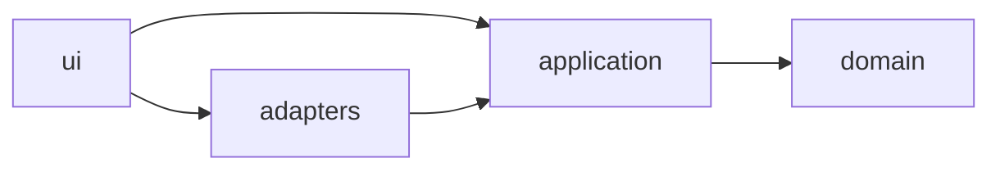

# Check my car park

A client-side tool for a car park owner or operator to check an OPMS v0.3 dataset against the real place and export a review document. Nothing is uploaded.

## Architecture

Dependencies point inward. The UI and adapters call the application. The application calls the domain. The domain does not know about the browser.



### Ports

The application defines ports in `src/application/ports.ts`:

- `SchemaValidatorPort` checks a dataset or a review document against the v0.3 JSON Schemas.
- `ClockPort` supplies the review timestamp.
- `StoragePort` autosaves a draft in the browser.
- `ReadableFile` is the small file shape the browser adapter can read.

The Ajv adapter, `localStorage` adapter, and SVG renderer sit in `src/adapters`. They are the only place that talks to those libraries.

### Tests

```bash
cd tools/review-app
npm install
npm run test:coverage
npm run test:bdd
npm run test:e2e
```

Unit tests cover the domain and the use cases. Gherkin scenarios in `features/` exercise the same use cases, including schema validation of the exported review. Playwright opens the built page, checks the simple example, exports a review, and runs axe.

Decisions are recorded in `docs/adr/`.
